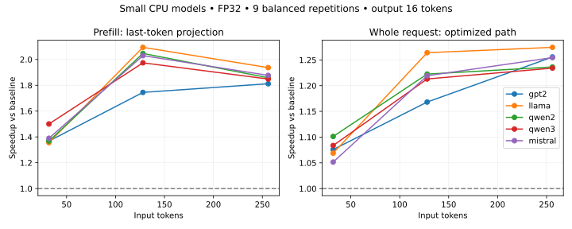

# Model coverage, modularization and CPU optimization — 2026-10-19

## Validation

- 16 unit tests passed; five dense architecture families, 120 actual model cases.
- GPT-2, Llama, Qwen2, Qwen3, Mistral; random seed17, two layers, FP32 CPU.
- Input lengths2/7/19/63, output lengths1/6/16, full-prompt and prefix-only boundaries.
- All output tokens exact vs independent no-cache oracle; maximum logits error1.7881393432617188e-7 (`atol=1e-6, rtol=1e-5`).
- Local pretrained Qwen2.5-0.5B-Instruct and1.5B-Instruct: each two natural-language prompts (Korean/English, lengths18/11), two boundaries, eight output tokens. All8cases/64tokens exact; max logits error5.245208740234375e-5 (`atol=2e-4, rtol=2e-4`, declared before execution).
- Immutable pretrained revisions and weight hashes: `qwen05.json`, `qwen15.json`. No downloads were needed. Qwen3-0.6B had no cached weight file and was not run as a pretrained checkpoint.
- Sliding/hybrid/cross-attention and unknown model families fail explicitly. Mistral cases use an explicitly full-attention config; this does not establish sliding-window checkpoint support.

## Changes

SDK-free contracts moved to `contracts.py`; model capabilities to `torch_models.py`; cache storage/transport to `torch_cache.py`. `runtime.py` now only orchestrates ownership and execution. Compatibility imports are retained. See [contributor guide](../../CONTRIBUTING_PD.md).

Prefill uses `logits_to_keep=1`; ordinary decoding no longer copies full vocabulary logits to CPU. `capture_logits=True` remains available for diagnostics. KONI mandatory parity checks and the hardware transfer path are unchanged.

## CPU ablation

Five randomly initialized models, hidden128, two layers, vocabulary8192, FP32, two CPU threads; inputs32/128/256, output16. Each condition has two warmups and nine measured repetitions. Variant order rotates evenly. All405 measured requests pass token parity. The three variants are old-behavior baseline (full prompt logits + capture), last-token logits + capture, and fast (last-token logits, no capture). Raw repetitions, phase times and every condition are retained.

| Model | Input tokens | Baseline total ms | Fast total ms | Total speedup | Prefill-only speedup |
|---|---:|---:|---:|---:|---:|
| gpt2 | 32 | 12.210 | 11.349 | 1.076× | 1.368× |
| gpt2 | 128 | 15.548 | 13.310 | 1.168× | 1.745× |
| gpt2 | 256 | 18.415 | 14.665 | 1.256× | 1.812× |
| llama | 32 | 13.487 | 12.618 | 1.069× | 1.356× |
| llama | 128 | 19.082 | 15.095 | 1.264× | 2.094× |
| llama | 256 | 22.390 | 17.568 | 1.275× | 1.937× |
| qwen2 | 32 | 14.458 | 13.128 | 1.101× | 1.368× |
| qwen2 | 128 | 18.752 | 15.339 | 1.223× | 2.047× |
| qwen2 | 256 | 22.366 | 18.090 | 1.236× | 1.858× |
| qwen3 | 32 | 15.323 | 14.140 | 1.084× | 1.501× |
| qwen3 | 128 | 19.945 | 16.442 | 1.213× | 1.974× |
| qwen3 | 256 | 23.735 | 19.232 | 1.234× | 1.849× |
| mistral | 32 | 13.911 | 13.229 | 1.052× | 1.390× |
| mistral | 128 | 18.443 | 15.127 | 1.219× | 2.030× |
| mistral | 256 | 22.931 | 18.278 | 1.255× | 1.877× |



Prefill speedup isolates the projection change (baseline vs last_logits). Total speedup compares baseline vs fast. These are within-run CPU medians, not confidence intervals, production throughput or NPU speedups. The pretrained runs establish parity, not a pretrained performance benchmark.

## Reproduction

From the workspace root:

```bash
PD_VALIDATION_REPORT=/tmp/parity.json PYTHONPATH=aicomp-integration/opt_prime:hetero-npu-p2p/src python3 -m unittest discover -s aicomp-integration/opt_prime/tests -v
PYTHONPATH=aicomp-integration/opt_prime python3 aicomp-integration/opt_prime/examples/pd/benchmark_torch.py --out /tmp/new-ablation --repeats 9
PYTHONPATH=aicomp-integration/opt_prime python3 aicomp-integration/opt_prime/examples/pd/validate_checkpoint.py --model-dir /path/to/immutable/snapshot --model-id Qwen/Qwen2.5-0.5B-Instruct --out /tmp/new-checkpoint-validation
```

Torch2.11.0+cpu, transformers5.8.1. The compiled NPU graphs were not modified or rebenchmarked in this change; additional models on RNGD/ATOM require their own graph compilation, KV layout validation and real hardware tests. No new quality, MFU or power claim is made.
